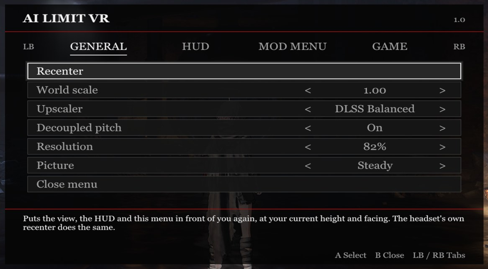
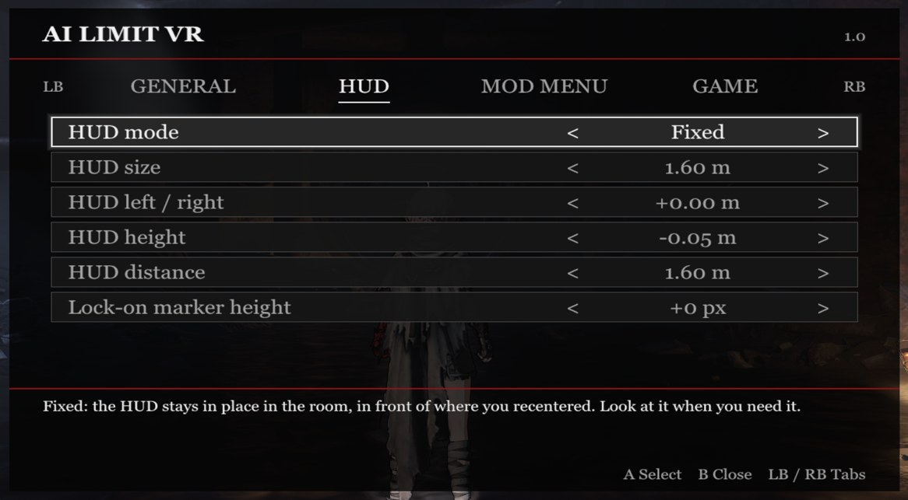
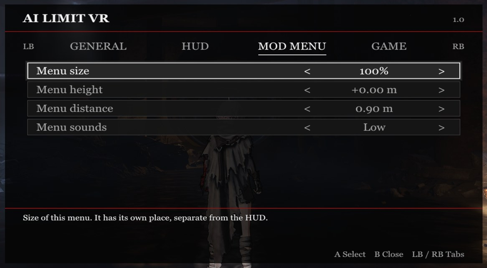
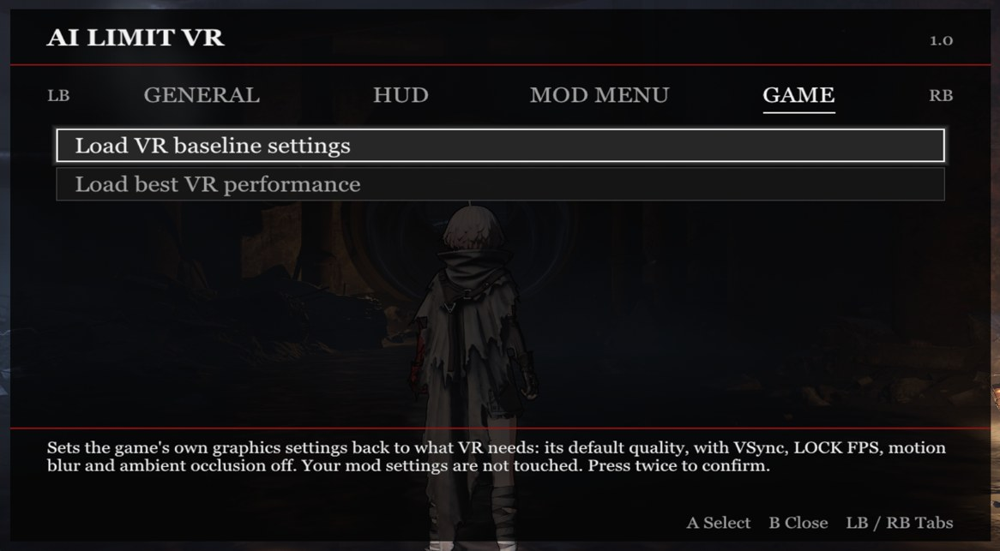

# AI Limit VR

True stereo VR for AI LIMIT. Both eyes are drawn from the same game tick, with no alternate-eye shimmer and no warping. Your headset sits at the game's third person camera: look around freely while you play seated with a gamepad. NVIDIA DLSS runs in each eye.

**Download:** see [Releases](../../releases).

**Support:** this mod is free. If you enjoy it, you can [buy me a coffee](https://buymeacoffee.com/scubasteve2365).

## What you need

- The Steam version of AI LIMIT
- A PC VR headset with an OpenXR runtime. Two have been tested:
  - SteamVR, set as your OpenXR runtime (SteamVR settings, OpenXR), on a Pimax Dream Air
  - Virtual Desktop's VDXR, on a Meta Quest 3
- An Xbox type gamepad (PlayStation pads through Steam Input)
- For DLSS, an NVIDIA RTX graphics card. Other cards can use TAA in the mod menu

## Install

1. Unzip the release anywhere.
2. Double click `Install AILimitVR.bat` and type 1. It finds the game through Steam.
3. Start SteamVR or connect Virtual Desktop, then start the game from Steam. VR starts by itself and centres the view after a second.

To uninstall, run the same bat file and type 2. No game files are changed.

If another mod already uses `winhttp.dll` in the game folder (BepInEx does), the installer renames it to `winhttp_chain.dll` and this mod loads it first. Uninstall puts it back.

The mod is not signed, so Windows may warn you about the bat file. It is plain text, so you can read it first. Windows Smart App Control can block unsigned mod DLLs; if it is on and the game stays flat, that is the likely cause.

If VR does not start, a message box says why and what to do, and the game runs on the monitor.

## Settings

Hold both sticks in for half a second to open the menu in the headset, or press Insert on the keyboard. The game gets no input while it is open. LB and RB (Page Up and Page Down) switch tabs, up and down choose a setting, left and right change it, A (Enter) selects and B (Esc) closes. Every row shows a short explanation at the bottom of the menu.

### General



| Setting | What it does |
|---|---|
| Recenter | Puts the view, the HUD and the menu in front of you again. Your headset's own recenter does the same |
| World scale | 1.00 is life size. Higher makes the world smaller with more 3D depth |
| Upscaler | TAA, DLAA, or DLSS Quality, Balanced (default), Performance or Ultra Performance in each eye. Applies at once |
| Decoupled pitch | On (default) keeps the world level: the stick and lock-on no longer tilt your view, you look up and down with your head. Off tilts the view with the game's camera |
| Detail distance | Full (default) keeps the same detail, ground and props at distance as the flat game. Medium and Short drop them sooner and save a little CPU time |
| Resolution | 100% is the size your headset asks for. Takes effect the next time you start the game |
| Picture | Auto (recommended) uses Steady on Virtual Desktop and Panel on SteamVR. Steady draws the HUD and menu into the 3D picture, which holds still on Virtual Desktop. Panel shows them as separate sharp panels, best on SteamVR |

### HUD



| Setting | What it does |
|---|---|
| HUD mode | Fixed (stays in place in the room), Follows head, or Hidden. The game's full screen menus show on the same panel |
| HUD size, left / right, height, distance | Where the HUD panel floats |
| Lock-on marker height | Raises or lowers the lock-on orb on the HUD panel |

### Mod Menu



| Setting | What it does |
|---|---|
| Menu size, height, distance | Where this menu floats. The HUD does not move |
| Menu sounds | Soft clicks: Off, Low, Medium or High |

### Game



| Setting | What it does |
|---|---|
| Load VR baseline settings | The game's default quality with VSync, frame lock, motion blur and ambient occlusion off. Press twice |
| Load best VR performance | Lowest shadows and fog, ambient occlusion and motion blur off, DLSS on. Press twice |

## Game settings

While VR runs, the mod keeps the game's VSync and frame lock off, because it paces the game to your headset. It starts each game frame on your headset's own frame tick, for even motion. It also turns off film grain, bloom, motion blur, the game's radial blur, depth of field and ambient occlusion: they look wrong in VR or differ between the eyes.

## Performance tips

- **SteamVR throttling first.** In SteamVR Settings, Video, Per-application video settings, pick the game and set **Throttling Behavior** to **Fixed** at your headset's refresh rate, and turn **Motion Smoothing** off.
- **DLSS Balanced** held 72 Hz on an RTX 5090 at a high SteamVR resolution. If your card struggles, try DLSS Performance or lower the Resolution.
- Game speed is correct at 72, 90 and 120 Hz.
- **Resolution and DLSS change graphics card load only.** If fpsVR shows missed frames with the graphics card well under budget, the CPU is the limit: lower the game's shadow quality, or set Detail distance to Medium.
- Frames the game finishes late are handed to SteamVR late rather than covered up, so fpsVR and other tools show them honestly.

## Good to know

- The mod keeps the game offline: it refuses the game's internet connections.
- Your monitor shows nothing while VR runs; the game's flat picture is skipped to save time.
- Tested in real headsets through SteamVR (Pimax Dream Air) and Virtual Desktop's VDXR (Meta Quest 3), on NVIDIA RTX graphics. Other headsets should work through OpenXR but have not been tried. AMD and Intel graphics have not been tried. Reports are welcome.
- If something goes wrong, the log is `AILimitVR.log` in the game folder; crash dumps go to `AILimitVR\crashes`. Please attach them to an issue.

## Support

This mod is free. If you enjoy it and want to support more VR mods, you can
[buy me a coffee](https://buymeacoffee.com/scubasteve2365). Thank you!

## Building from source

You need Visual Studio's C++ tools with CMake, the Khronos [OpenXR loader](https://github.com/KhronosGroup/OpenXR-SDK-Source/releases) 1.1.65 for Windows, [MinHook](https://github.com/TsudaKageyu/minhook) source and [Dear ImGui](https://github.com/ocornut/imgui) 1.93.

```
cmake -S . -B out -A x64 -DOPENXR_DIR=<OpenXR loader folder> -DMINHOOK_DIR=<MinHook folder> -DIMGUI_DIR=<imgui folder>
cmake --build out --config Release
```

The output lands in `..\build`. `install\make_package.py` builds the release zip.

## Credits

Built with the Khronos [OpenXR loader](https://github.com/KhronosGroup/OpenXR-SDK-Source) (Apache-2.0), [MinHook](https://github.com/TsudaKageyu/minhook) (BSD-2) and [Dear ImGui](https://github.com/ocornut/imgui) (MIT). The OpenXR side and the winhttp.dll proxy come from [Cuphead VR](https://github.com/scubasteve2365/CupheadVR) and Ori & the Will of the Wisps VR by the same author. DLSS is the game's own. Licences are in the release zip.

MIT licensed, by scubasteve2365. This is a fan mod, not made or approved by Sense Games or CE-Asia. It contains no game files.
